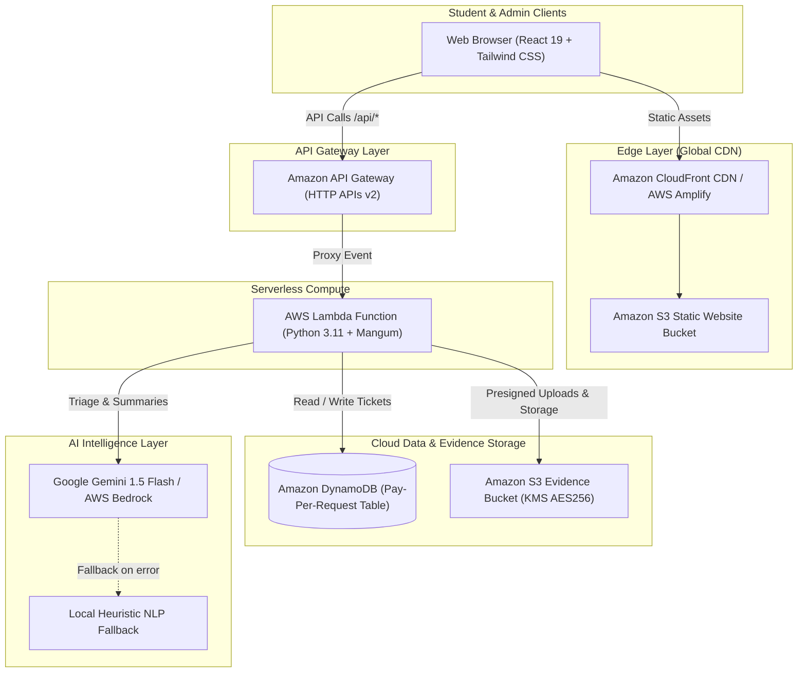

# CampusFix AI — AWS Cloud Architecture
### Built for AWS ShipIt Challenge | Techfest, IIT Bombay in collaboration with AWS

## 1. High-Level Architecture Diagram

---

## 2. Architectural Components

### A. Edge & Frontend Hosting: Amazon CloudFront + S3 / AWS Amplify
- **Hosting Strategy**: The Vite React SPA compiles to static HTML/CSS/JS in `frontend/dist`.
- **Global Edge Caching**: CloudFront caches static assets globally with low latency.
- **SPA Routing**: Configured with custom error response 404/403 rewrite to `/index.html` (HTTP 200).
- **Security Headers**: HSTS, Content-Security-Policy, and X-Content-Type-Options.

### B. API Routing: Amazon API Gateway (HTTP APIs v2)
- **Low Latency**: HTTP APIs v2 offers sub-10ms overhead compared to REST APIs.
- **Cost**: \$1.00 per million requests (3x cheaper than v1 REST API).
- **Routing**: `ANY /` and `ANY /{proxy+}` mapped directly to Lambda.

### C. Serverless Compute: AWS Lambda (Python 3.11/3.14 via Mangum)
- **Framework**: FastAPI wrapped by **Mangum ASGI adapter**.
- **Memory & Timeout**: Configured for 512 MB memory and 30-second timeout to handle cold-starts and AI payloads.
- **Stateless Execution**: Scales from zero to thousands of concurrent campus users with zero idle server cost.

### D. Primary Database: Amazon DynamoDB
- **Billing Mode**: `PAY_PER_REQUEST` (On-Demand) ensuring \$0.00 idle cost.
- **Single-Table Design**:
  - `PK`: `COMPLAINT#{id}`
  - `SK`: `METADATA`
  - `GSI 1 (CategoryIndex)`: `Category` (HASH) + `SK` (RANGE)
  - `GSI 2 (StatusIndex)`: `Status` (HASH) + `SK` (RANGE)

### E. Evidence Storage: Amazon S3
- **Bucket**: `campusfix-evidence-<account-id>`
- **Security**: Server-Side Encryption (`AES256`), Block Public Access enabled.
- **Upload Flow**: Presigned URLs or backend multipart upload with strict MIME verification (`image/jpeg`, `image/png`, `image/webp`).

---

## 3. Dual-Mode Local to Cloud Strategy

CampusFix AI implements the **Repository and Adapter Patterns**:
- In **Local Mode**: Uses `SQLAlchemyComplaintRepository` (`campusfix.db`) and `LocalStorageService` (`backend/uploads/`).
- In **Cloud Mode** (`USE_AWS_STORAGE=true`): Automatically activates `DynamoDBComplaintRepository` and `S3StorageService` without application code changes.
